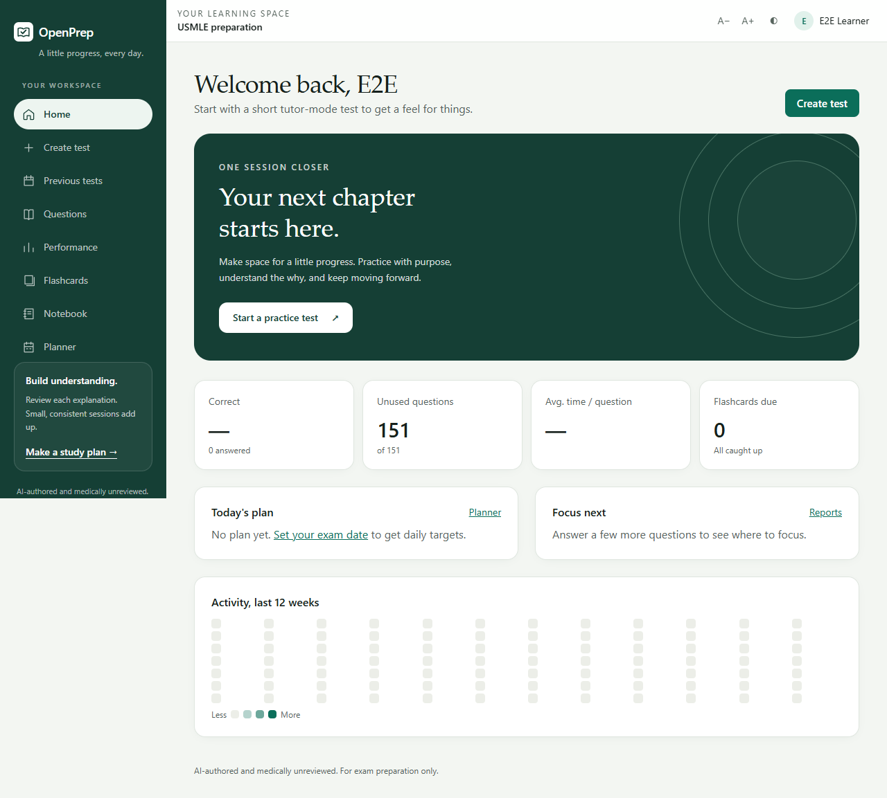

# OpenPrep UI redesign — 1 November 2026

Created with the connected Lovable MCP, then adapted to the existing Next.js application.

- [Lovable design editor](https://lovable.dev/projects/42368ac5-8cab-4495-bab9-12a1c94ed272)
- [Interactive design preview](https://id-preview--42368ac5-8cab-4495-bab9-12a1c94ed272.lovable.app)

The prototype contains illustrative data and placeholder secondary pages. The local OpenPrep implementation retains real analytics, planner, question bank, flashcards, notebook, test generation, scoring and explanations. Prototype data and placeholder routes were not copied into the application.

The design adds an evergreen desktop sidebar with active navigation pills, a sage canvas, editorial headings, a practice banner, spacious cards, and mobile navigation. Shared cards and headings update the existing test builder and secondary screens. Existing theme and text-size controls remain. Medical disclosures remain visible. Local fonts are used, with no new package or external font dependency.

## Validation

- TypeScript check and ESLint on changed TypeScript files passed.
- Production Webpack build passed.
- Eight desktop/mobile browser tests passed: public and signed-in accessibility, horizontal overflow, keyboard exam controls, active navigation, practice action, and dark dashboard accessibility. Signed-in coverage includes dashboard, create, questions, performance, flashcards, notebook, planner, settings, previous tests, exam and explanation.
- Screenshots below contain only synthetic users and disposable test fixtures. Visual inspection covered desktop and mobile dashboard screenshots.
- A final CSS adjustment allows sidebar scrolling on short screens and removes the sidebar and left gutter from print layout.
- The final build passed again after that adjustment; both desktop/mobile redesign tests passed again (2/2), including dark-theme accessibility. The owned disposable test container was removed after verification.

[Mobile dashboard](dashboard-mobile.png) · [Dark dashboard](dashboard-dark.png)

The initial design iteration was local. The approved UI was subsequently [deployed to production under an explicit release exception](PRODUCTION_STATUS.md), using an isolated copy of the previous production source. No Git commit, push, database migration or question import was performed. Existing Step 3 and compliance work was preserved. Physical-device and print-preview checks were not performed; automated accessibility checks do not establish complete accessibility compliance.
